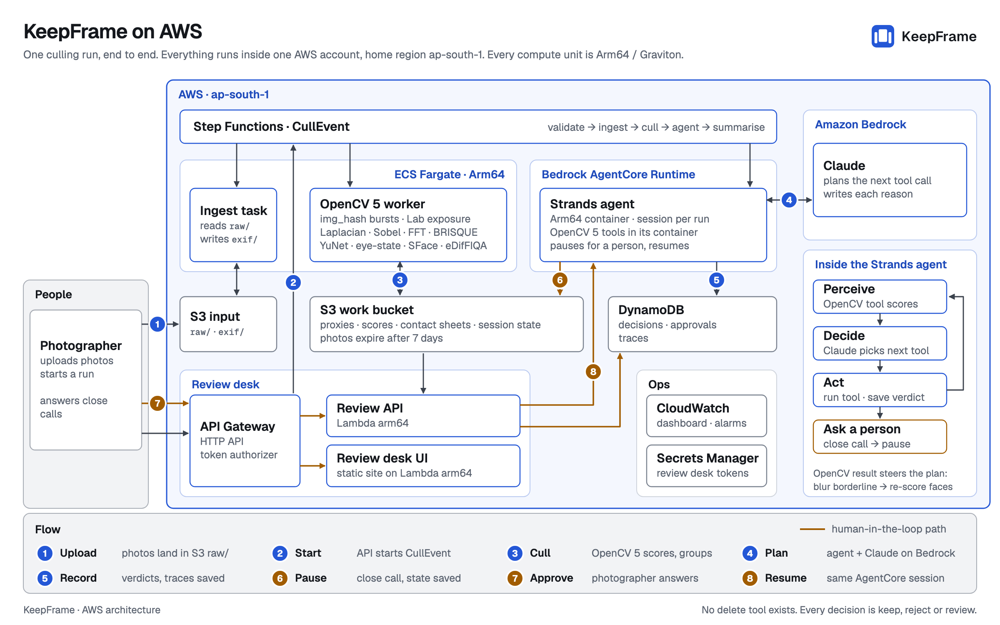
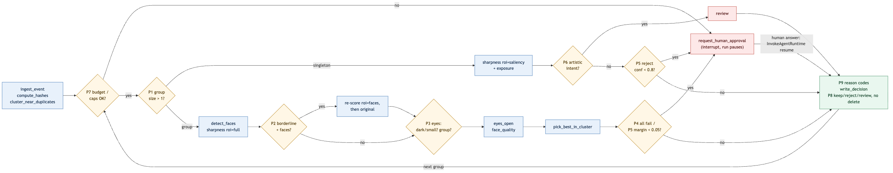

# KeepFrame: agentic photo culling with OpenCV 5 on AWS Graviton

*OpenCV AI Competition 2026, technical report*

<!-- Structure follows the competition's ten report items. Target: 12 pages or fewer as PDF (`make report-pdf`).
     Numbers are measured (with the evidence file named) unless labelled as design parameters or estimates. -->

**Team:** KeepFrame · **Repo:** https://github.com/Hitesh-Sisara/keepframe-ai (public, Apache-2.0) · **Demo:** https://fnua4aumrl.execute-api.ap-south-1.amazonaws.com/ui/ ("Explore the demo", no sign-in; read-only judge token in Devpost private notes) · **Video:** https://www.youtube.com/watch?v=lAsRbTtC7Kc

**Path:** Agentic Vision. We do not enter Best Use of COOL: COOL carries an AWS Marketplace software fee and this project spends AWS credits only (§5, §6).

## 1. Problem and users

**Problem.** An Indian event photographer or studio shoots 2,000–10,000 frames per event, often over several days and with several shooters. Before delivery they *cull*: drop blurred frames, closed eyes, exposure failures and the redundant frames in 5–20-frame bursts, then pick the best frame of each burst. Commercial culling tools (Aftershoot, Narrative Select, FilterPixel) report that culling by hand takes 4–12 hours per event. Many photographers already upload every event to cloud storage for delivery: the processed WebP (2560 px or less), usually the original, and EXIF capture time, camera and lens. Without grouping or quality scoring there, they cull on a laptop before uploading or deliver uncurated galleries. KeepFrame moves culling to the cloud, after the upload to S3, where the pixels already are.

**Users.**

| User | Benefit |
|---|---|
| Event photographers and studios | Hours back per event. A ranked keeper set with a reason for every verdict |
| Teams building photo products (galleries, delivery, studio software) | The same culling through one API, under their own brand |
| Couples and guests | Faster, cleaner galleries with fewer closed-eye frames |
| Photo-service operations | A per-event quality report (blur %, duplicate %) that predicts support load and storage savings |

**Impact (estimates, not measurements).** Assumptions for one mid-size photo service: about 35k events hold photos; about 14M photos are uploaded per year; 15–30% of event frames are technical rejects or burst redundants (the conservative end; commercial tools and photographer surveys cite 30–60%); manual culling runs at 1,000–1,500 frames/hour (we use 1,250).

| Metric | Derivation | Estimate |
|---|---|---|
| Frames per year that could be auto-flagged | 14M × 15–30% | 2.1M–4.2M |
| Manual culling hours per year across that service | 14M ÷ 1,250 frames/h | about 11,000 h |
| Per 4,000-frame event | 4,000 ÷ 1,250 | about 3.2 h manual → target 40 min or less of review (about 80% saved) |
| Redundant originals per year | 15–30% × 14M × about 5 MB | 10–21 TB |

A photographer time study (§7) would test the per-event target; it has not been run yet, so the target is unverified.

**Scope.** In scope: offline culling of an uploaded event, grouping, per-image and per-face scores with reasons, best-of-burst selection, a non-destructive keep/reject/review manifest, the review UI, the agent trace, an Arm OpenCV 5 benchmark, and evaluation on hand-labelled data. Out of scope: modifying or deleting the uploaded photos, RAW files, per-photographer style learning, mobile UI, real-time culling during upload.

## 2. System overview



1. The photographer uploads the event's photos to `raw/<eventId>/` in a private S3 bucket. An `Ingest` Lambda builds the per-event manifest from them (or uses one uploaded with the photos).
2. Optional: an ECS Fargate ARM64 task (`SyncSource`) imports an event from any S3-compatible store instead.
3. Step Functions runs the OpenCV 5 worker on Fargate ARM64. The worker builds proxies, hashes, clusters and scores.
4. Step Functions then starts the Strands agent on **Amazon Bedrock AgentCore Runtime** (ARM64 container, HTTP `/invocations` and `/ping`): a Lambda shim calls `InvokeAgentRuntime` with `mode=start`, and a second shim polls `mode=status` every 30 s. The agent calls Claude on Amazon Bedrock (default) or, optionally, any Anthropic-compatible endpoint.
5. The agent plans further OpenCV 5 tool calls from those results, asks a human about uncertain items, and writes decisions.
6. S3 holds every per-photo verdict (`results/<eventId>/<runId>/decisions.jsonl`), groups and traces; DynamoDB holds run records, approvals and the agent and human decisions that override the worker's. The review UI and the API Gateway + Lambda arm64 API show them (interim UI hosting: a static export served by an arm64 Lambda on the same HTTP API, §5).
7. CloudWatch carries logs, metrics, dashboards and agent spans.

With the default Bedrock provider nothing leaves the AWS account; the optional Anthropic-compatible provider is the one setting that calls outside it (§5). All compute is Arm on AWS.



*Agent workflow (compact). Full version: `docs/agent_workflow.png`.*

### Review desk and judge access

The review desk opens on an Overview of the event. Burst groups show the reason and confidence for each verdict, with a face close-up strip, compare and loupe views, and a full-screen cull mode. A trace story mode replays the agent's steps. The approvals desk shows the candidate frames large. The benchmark view includes a cost calculator. The desk has dark mode and a keyboard shortcut sheet. Accessibility work targeted WCAG: Lighthouse accessibility scores 99–100, but full compliance would need manual testing with assistive technology, which we have not done.

"Explore the demo" needs no token. It uses licensed CC BY sample photos, and its data was captured from a real Claude planner run; approvals answered by a script are labelled as scripted. Judges can open the live desk with a read-only token, which the API refuses for writes (403). Photos are kept for 7 days (§9), so the live view shows no images for older runs.

## 3. OpenCV 5 implementation

**Environment.** `opencv-contrib-python-headless==5.0.0.93` (aarch64 `manylinux_2_28` wheel, `Custom HAL: carotene`; installed by `scripts/install_opencv_wheel.sh`, which checks the SHA-256 and asserts the HAL; every run records `opencv_hal`, see §6), `numpy==2.3.3`; agent stack `strands-agents==1.57.2`, `anthropic==1.11.0`, `bedrock-agentcore==1.24.0`, `boto3==1.43.108`, `mcp==2.1.1`; `OPENCV_FORCE_DNN_ENGINE=3` (new DNN engine first, classic engine as fallback). The contrib modules used are `img_hash`, `quality`, `saliency` and `xphoto`; a startup assertion checks all four. Every process logs `cv2.__version__`, `cv2.__file__` and the first 40 lines of `cv2.getBuildInformation()` to CloudWatch. Source: `docs/DEPLOY.md` evidence section.

```
# ECS task cull-probe, Fargate ARM64 (cpuArchitecture=arm64, exit 0), CloudWatch /keepframe/probe
5.0.0 /usr/local/lib/python3.12/site-packages/cv2/__init__.py aarch64
# cull-worker start-up line, Fargate ARM64 4 vCPU, CloudWatch /keepframe/worker (excerpt)
{"event":"opencv_build","opencv_version":"5.0.0","cv2_file":"/usr/local/lib/python3.12/site-packages/cv2/__init__.py",
 "contrib":["img_hash","quality","saliency","xphoto"],"font_face":true,"dnn_engine":"3"}
```

**OpenCV 5 API changes that shaped the design.** `features2d` became `features` and `calib3d` became `geometry`. `CascadeClassifier` moved to contrib `xobjdetect`, so we use no Haar eye cascades: eye state comes from `cv2.FaceDetectorYN` plus a DNN classifier. The Caffe/Darknet parsers are gone, so every model is ONNX. `warpAffine`/`remap` numerics differ slightly from 4.x, so every threshold was derived on 5.x.

**Image variants.** Each image is decoded once with `cv2.imdecode(buf, cv2.IMREAD_COLOR)` from the processed WebP. `p1024` = `cv2.resize(..., interpolation=cv2.INTER_AREA)` to a 1024-px long edge. `p1024_gray` = `cv2.cvtColor(..., COLOR_BGR2GRAY)`. The original is used only for sharpness tie-breaks. OpenCV cannot decode HEIC, so for HEIC originals the worker uses the WebP and records `variant_fallback=true`. All thresholds live in `config/thresholds.yaml`, and their hash (`thresholds_sha`) goes into every trace header.

| Tool | OpenCV 5 APIs | Starting thresholds (1024 px) | Output |
|---|---|---|---|
| `compute_hashes` | `cv2.img_hash.pHash`, `blockMeanHash(mode=BLOCK_MEAN_HASH_MODE_0)`, `colorMomentHash`; Hamming via `np.unpackbits` | n/a | 8 B / 32 B / 42 float hashes per photo; MD5 for exact duplicates |
| `cluster_near_duplicates` | Union-find over pairs inside camera + `clickedAt` ±10 s buckets (sub-second time from EXIF when present). Optional for groups larger than 8: `cv2.ORB_create(500)` + `BFMatcher(NORM_HAMMING)` + `estimateAffinePartial2D(USAC_MAGSAC)` + `cv2.quality.QualitySSIM_compute` | Edge if pHash ≤ 10, or blockMean ≤ 25 and \|Δt\| ≤ 3 s. Split if SSIM < 0.85 | Groups with `span_s`, `size` |
| `score_sharpness` | `cv2.Laplacian(CV_64F, ksize=3).var()`; Tenengrad from `cv2.Sobel`; FFT high-frequency energy (60-px centre window removed at 500 px); `cv2.quality.QualityBRISQUE_compute` (only when the votes disagree). ROI: full, faces (boxes +20%), or saliency (`StaticSaliencyFineGrained`, threshold at 0.6 × max) | `lap_var` < 60 blurry, 60–120 borderline, > 120 sharp; `fft_hf` < 10 blurry vote; BRISQUE > 55 poor vote. Directional Sobel energy ratio > 2.5 → `BLUR_MOTION`, else `BLUR_FOCUS` | Label + confidence (\|lap_var − 90\| / 90 clipped to [0.3, 0.95], adjusted for vote agreement) |
| `score_exposure` | `cv2.cvtColor(BGR2Lab)`, `cv2.calcHist` on L | Over: clip_hi > 5% and mean_L > 200. Under: clip_lo > 40% and mean_L < 45. Low contrast: std_L < 25 | ok / under / over / low_contrast. "Under" alone is a review, not a reject |
| `detect_faces` | Reuses face boxes from the manifest when present; otherwise `cv2.FaceDetectorYN.create(yunet, "", (w,h), 0.9, 0.3, 5000)` at a 1024-px long edge, retried at 1600 px if the manifest's face count says faces exist | score ≥ 0.9 | Boxes, 5 landmarks, source |
| `score_eyes_open` | Eye crops of side 0.5 × inter-ocular distance around the YuNet landmarks; OCEC-M via `cv2.dnn.readNet(onnx)`, `blobFromImage` to 1×3×24×40 RGB, sigmoid `prob_open` | open: both eyes ≥ 0.6; closed: both ≤ 0.3; unknown if face minPx < 40 or crop < 16 px | Per-face state, `any_main_subject_closed` |
| `score_face_quality` | `cv2.FaceRecognizerSF.alignCrop` → 112×112 → eDifFIQA(T) via `cv2.dnn`; per-face Laplacian variance | FIQA > 0.5 counts as good | Per-face quality, main subject id |
| `pick_best_in_cluster` | Deterministic, no model call | Score = 0.35·sharp_faces + 0.25·eyes_open + 0.15·exposure_ok + 0.15·fiqa + 0.10·composition; tie if margin < 0.02 | Ranking, margin, tie |
| `enhance_keeper` | `cv2.createCLAHE(2.0, (8,8))` on L; `cv2.fastNlMeansDenoisingColored(h=3, hColor=3, 7, 21)` only if ISO ≥ 3200 or BRISQUE > 50; `cv2.xphoto.createGrayworldWB` | Top 50 keepers per event | Preview JPEG + `delta_brisque`. Originals are never touched |
| `make_contact_sheet` / `blur_faces_for_publication` | `cv2.resize`, `cv2.hconcat`, `cv2.putText` with `cv2.FontFace`; `cv2.GaussianBlur` on YuNet boxes | n/a | Contact sheets for approvals; blurred images for publication |

**Thresholds in use** (`config/thresholds.yaml` version 1). The deployed runs of 2026-10-05 to 2026-10-08 (E07, the AgentCore E03 and E01 runs) and the 2026-10-08 bench rows record `thresholds_sha` `9467e8382e93ec9d58c872a6fc1e12cf4f66ccf717edcfb2ec9f08a71d2cd3af`; the 2026-10-09 determinism runs do not record one. Since the 2026-10-09 releases the deployed sha is `a4c5c7005fac92b42ece11ad74760f83c42bec1dd6c214322810f501a38d4a32`, which only adds two group-eyes keys for C08 (`group_eyes_min_closed` 2, `group_eyes_share_den` 3). Every value in the table above is still the plan's starting value. Real data added rules, not retuned values: subject-aware and venue-relative exposure (`EXPOSURE_UNDER` needs the brightest face L < 40 and frame mean L < 0.5 × the event median; `EXPOSURE_OVER` needs ≥ 20% of the most clipped face at L ≥ 250 and mean L > event median + 40), one P5 question per group (`max_tied_candidates` 3), near-identical runners-up rejected at confidence 0.95 (`burst_near_gap` 0.01), a duplicate needs a best-score gap < 0.05, and sharpness min-max spread reaches full weight only at a 4× `lap_var` ratio. Earlier runs record the sha they used (`d44e66f3…` for the first E09 run, `badbd08f…` for the untuned x86 runs). These are the values every reported result used. They have not been tuned on the labelled set, because labelling has not started (§7).

Per-stage latency per image, one worker process with `cv2.setNumThreads(1)`. Stock OpenCV 5.0.0 on Graviton4 `c8g.xlarge`, real 5,000-photo set, median of 3 reps. Source: `bench/results/2026-10-05/results.md`.

| Stage | p50 ms | p95 ms |
|---|---|---|
| WebP decode | 32.2 | 47.2 |
| resize → 1024 (INTER_AREA) | 12.9 | 13.6 |
| cvtColor gray | 0.23 | 0.24 |
| CLAHE | 2.5 | 2.8 |
| Laplacian + Sobel | 6.4 | 7.5 |
| pHash + blockMeanHash | 0.30 | 0.32 |
| YuNet at 1024 | 59.2 | 62.3 |
| BRISQUE | 26.4 | 28.5 |
| **OpenCV total** | **139.8** | **156.3** |

YuNet, WebP decode and BRISQUE account for about 84% of per-image time. Resize, CLAHE and the filters account for about 16%.

**Models and licences.**

| Model | Licence |
|---|---|
| YuNet (`face_detection_yunet_2023mar.onnx`, opencv_zoo) | MIT (Shiqi Yu) |
| SFace (`face_recognition_sface_2021dec.onnx`, opencv_zoo) | Apache-2.0 |
| eDifFIQA(T) (`ediffiqa_tiny_jun2024.onnx`, opencv_zoo) | CC-BY-4.0 (Babnik, Peer, Štruc, IEEE T-BIOM 2024) |
| BRISQUE model/range YAML (opencv_contrib `quality` samples) | Apache-2.0 |
| Eye state: OCEC-M (`ocec_m.onnx`, PINTO0309/OCEC, 1.7 MB) | MIT (Katsuya Hyodo); trained on MichalMlodawski/closed-open-eyes (ODC-By 1.0, synthetic (machine-generated) faces) |

All models are pinned by URL and SHA-256 in `config/models.lock` and fetched at image build time (`scripts/fetch_models.py`); none is committed. OCEC-M was chosen over OCEC-S/L and three other candidates: with the 0.5 × IOD crop it called 0.2% of open eyes closed on 1,373 detected faces (`docs/CV_FACES.md`; that set is OCEC's training source, so it checks wiring, not generalisation). NIMA is not used: no licence-clean, numerically verified ONNX exists. Test face fixtures are 5 synthetic (machine-generated) images from the same ODC-By dataset (`tests/fixtures/faces/LICENCES.md`). Sources: `config/models.lock`, `models/README.md`.

## 4. Agentic loop

**Design.** The agent is a planner over OpenCV 5 tools. Every tool is a plain Python function that runs OpenCV 5 and returns a JSON dict; `keepframe/agent/toolset.py` wraps each one with Strands `@tool`. A Claude planner chooses the next tool and its arguments from the previous results. A smaller Claude model can rewrite the template reason text. Each policy below appears in the system prompt **and** is enforced in code by Strands hooks, so the model cannot skip it.

**Model provider.** `KEEPFRAME_LLM_PROVIDER` selects it. The default, `bedrock`, is Claude on Amazon Bedrock via Strands `BedrockModel`: planner `in.anthropic.claude-sonnet-5`, reason-writer `in.anthropic.claude-haiku-4-5-20251001-v1:0` (India inference profiles, `KEEPFRAME_BEDROCK_MODEL_ID` / `KEEPFRAME_BEDROCK_REASONS_MODEL_ID`), authorised by the AgentCore role's IAM policy. The optional `anthropic` setting uses the official `anthropic` SDK via Strands `AnthropicModel` against any Anthropic-compatible endpoint (`ANTHROPIC_BASE_URL`; the key lives in Secrets Manager `keepframe/anthropic`), planner `claude-sonnet-5`, reason-writer `claude-haiku-4.5`. `fake` selects a deterministic scripted model for tests. Each trace line records the `model` it used.

| # | Policy | Effect on the next action |
|---|---|---|
| P1 | Group first, then score inside groups | Singletons get only saliency-ROI sharpness + exposure. Groups get faces → eyes → face quality → best-of-burst |
| P2 | Borderline sharpness → re-score | `lap_var` 60–120 with 1 or more faces → `score_sharpness(roi="faces")`; still borderline and an original exists → `variant="original"`. A bokeh portrait is not rejected for a soft background |
| P3 | Eyes are per-face and context-aware | Reject `EYES_CLOSED` only if the main subject (largest face, minPx ≥ 40) is closed with p ≥ 0.8. With 3 or more faces and one non-main face closed → `review` (`REVIEW_POLICY_GROUP_EYES`). Dark scene with small faces → skip eye-state |
| P4 | Never reject a whole group | If every frame fails, the best one is `keep` (`KEEP_BEST_OF_GROUP`) and the group goes to a human |
| P5 | Low confidence → human | Reject with confidence < 0.8, margin < 0.05, or tie → `request_human_approval` with a contact sheet |
| P6 | Artistic-intent guard | `BLUR_MOTION` with ExposureTime ≥ 1/30 s, or a dark dance-floor frame → `review` (`REVIEW_ARTISTIC_INTENT`) |
| P7 | Budget-aware | Less than 20% budget left → skip the optional tools (composition, enhancement) |
| P8 | Never delete | `write_decision` accepts only keep/reject/review. No delete tool exists |
| P9 | Explain every verdict | 1 or more reason codes from a fixed vocabulary + a reason of 140 characters or less, generated from the tool numbers |

**What real data changed (P5 and exposure).** The third real event (E07 Engagement, 1,000 photos) was a studio burst shoot: 86.8% of frames sit in bursts of up to 75 frames. On it, the first policy set over-escalated. P5 was applied to every runner-up in a group, and near-identical frames have ranking margins near 0.00, so each runner-up became its own human question. EXPOSURE_OVER also fired on studio flash. We changed three things:

- P5 now asks **once per group**, about the keep slot (the kept frame vs its strongest distinct alternative).
- Near-identical runners-up are rejected as `BURST_NOT_BEST` with confidence 0.95.
- `EXPOSURE_OVER` is judged **relative to the event's own exposure distribution**, not a fixed threshold.

The trade-off we accepted: a runner-up with distinct merit is added to the group's single question instead of getting its own review.

| E07 (1,000 photos) | keep / reject / review | human questions | EXPOSURE_OVER flags | failed frames |
|---|---|---|---|---|
| Before (deployed run) | 292 / 258 / 450 | 686 | 159 | 83 (see §8, case 2) |
| After (local calibration rerun, then the complete deployed run) | 301 / 624 / 75 (7.5% review) | 98 over 171 groups (local rerun) | 0 | 0 of 1,000 |

The fix was calibrated on a local rerun (`run_kind=local_calibration`). The complete deployed run then reproduced the same verdicts (§5). Whether the extra 366 rejects are right is a labelling question. §7 reports it once labels exist. Source: `docs/EVALUATION.md`.

**Autonomy boundaries.** The agent may propose keep, reject or review, each with a reason and a confidence. It cannot delete, move, or modify the uploaded photos. Hard caps are enforced by hooks: 25 tool calls or fewer per group, 1.5 × N_photos or fewer per event, 60 minutes or less wall-clock, and at most 3 retries per failing tool. Hitting a cap escalates to a human and never loops.

**Human in the loop.** `request_human_approval` raises a Strands interrupt from a `BeforeToolCallEvent` hook. Agent state is persisted to `s3://…/sessions/<run_id>.json` and the run reports `paused` to the Step Functions status loop. The review UI shows the pending item with its contact sheet and scores. `POST /approvals/{id}` records the human verdict and note, then calls `InvokeAgentRuntime` with `{"mode":"resume","run_id","decisions"}` on the same deterministic `runtimeSessionId` (≥ 33 characters, derived from the run). The agent resumes at the same point; if the session has idled out, a new session restores the state from S3. The decision is then written with `decided_by=human`.

**Vision result changes the next action.** The Agentic Vision award asks for proof that perception changes the next action. We show three moments and state where each one was observed.

**Real run.** Event of 661 photos, planner `claude-sonnet-5` via the Anthropic-compatible provider setting. The run made 115 tool calls (102 excluding `next_work_item`) and paused 10 times for human approval. Every pause resumed in a different process from the one that paused, with agent state restored from S3. Full trace: `results/<eventId>/trace.jsonl`.

**Deployed AWS run (2026-10-05, before the move to AgentCore).** A second real event (664 photos) ran through the deployed `CullEvent` state machine, every compute step on Fargate ARM64, including the agent: ValidateManifest → source sync → CullWorker → RunAgent → Summarise → Notify. The worker took 20.2 s (32.9 images/s). Agent tool p50 latency was 102 ms on Fargate up to the first pause (91 ms over the whole run including its resumes, `eval/results/agent_metrics.csv`). The agent paused for approval. The deployed HITL path was then proven end to end: `POST /approvals/{id}` on the deployed API launched a Fargate ARM64 agent task with `--resume`, which restored the session, applied the answer, and paused again at the next close call. That single answer was a mechanism test by the team, not a photographer's judgement, and is excluded from every agreement figure. Source: `eval/results/first-run/agent_loop_metrics_2026-10-05.md`.

**On AgentCore Runtime (2026-10-08).** A probe (fake model, stub tools) first proved start → pause → resume → next pause on one runtime session. The first real-model run on the CDK-managed runtime, `run_aws_e03_agentcore_20261008T050441Z`, paused for approval after 31 s (8 tool calls); a `POST /approvals/{id}` on the deployed API resumed it on the same session (HTTP 200 in 0.77 s) and it paused at the next item. That answer was the team's mechanism test (`lead_test`), excluded from every agreement figure. Full events on AgentCore: §5 and `docs/evidence/E01_2442_agentcore.md`. Source: 2026-10-08.

**Approvals were scripted in this run.** A script answered all 10 approval requests by accepting each proposal as-is. No person looked at the frames. The run therefore shows the pause/resume mechanism working, not human judgement. The "human agreed with the agent" figure in §7 does not count these answers.

| Moment | Where it occurred |
|---|---|
| 1. Borderline full-frame sharpness → face-ROI re-score (P2) | **Synthetic scenario only.** It did not occur on any of the 4 real events we culled (see "Evaluation data gap", §7) |
| 2. Eyes closed on a secondary face → compare within the group (P3) | Real data, in the run above |
| 3. Small `pick_best_in_cluster` margin → contact sheet → `request_human_approval` → resume → `write_decision(decided_by=human)` (P5) | Real data, in the run above (scripted approval) |

Moments 2 and 3, real E09 run (`claude-sonnet-5`, 2026-10-05), seq 244–266 of `results/<E09>/trace.jsonl`. Ids replaced with synthetic ones; values verbatim; arguments shortened.

```
244 next_work_item         → g_0950, 2 frames, "worker flagged the group for a human check (margin 0.016)"
255 score_eyes_open        p_5101: f0 (main) open 1.00/1.00, f3 closed 0.10/0.05
                           p_5102: f0 (main) open 1.00/1.00, f3 partial 0.10/1.00
                           any_main_subject_closed = false in both → compare within the group (P3)
256 pick_best_in_cluster   → best p_5102, margin 0.0229, tie false
258 model_reasoning        "[p_5102] wins with margin 0.0229, below 0.05, so still escalating per P5"
259 make_contact_sheet     → sheets/…/g_0950.jpg, 2 tiles
261 request_human_approval proposed keep p_5102, review p_5101
263 interrupt_resumed      40 s later, new process; answer "approved as proposed"  [SCRIPTED APPROVAL]
265 write_decision         p_5102 keep KEEP_BEST_OF_GROUP; p_5101 review REVIEW_POLICY_GROUP_EYES + BURST_NOT_BEST
```

Moment 1, **synthetic scenario** (`python -m keepframe.agent.run --demo`, fake model, stub tools), `results/ev_demo/trace.jsonl`:

```
05 score_sharpness roi=full   p_8831 lap_var 74.2 → borderline (0.55)
11 detect_faces               2 faces, main 212 px
13 model_reasoning            "borderline on the full frame … Policy 2: re-score on the face ROI before labelling"
14 score_sharpness roi=faces  p_8831 lap_var 188.9 → sharp (0.92)
```

The 2026-10-05 trace stamped scripted answers `decided_by=human`; since the agent fix of 2026-10-08 they are stamped `scripted`, and no metric counts them either way.

The review UI renders the moment-3 chain for one group. It shows the approval as scripted for this run.

## 5. AWS deployment

Everything is provisioned by AWS CDK v2 (TypeScript) in `ap-south-1` as seven stacks: Network, Data, Compute, Workflow, Api, Ui, Observability. cdk-nag `AwsSolutionsChecks` runs on all of them. The agent runtime on Amazon Bedrock AgentCore is provisioned by an eighth stack, `AgentCoreStack`. All compute and data stay on AWS, on Arm. With the default Bedrock provider inference stays in the account too; the optional Anthropic-compatible provider is the only external call when it is chosen.

| Layer | Service | Architecture |
|---|---|---|
| Ingest | Photographer upload to S3 + `Ingest` Lambda; optional `SyncSource` ECS Fargate task (1 vCPU / 2 GiB, rclone) for an S3-compatible source | arm64 / ARM64 |
| OpenCV 5 worker | ECS Fargate, 4 vCPU / 8 GiB, stock wheel | ARM64 |
| Agent | Amazon Bedrock AgentCore Runtime: Strands + OpenCV 5 tools in one container, HTTP `/invocations` + `/ping`, PUBLIC network mode, consumption-billed; session idle timeout 900 s, max lifetime 8 h | ARM64 |
| LLM | Claude on Amazon Bedrock (default); any Anthropic-compatible endpoint (optional) | n/a (managed API) |
| Orchestration | Step Functions Standard + Lambda; `RunAgent` = `invoke_agent` → Wait 30 s → `agent_status` → Choice (running loops; paused/done continue; error fails the run), 2 h budget | arm64 |
| API | API Gateway HTTP API + Lambda (FastAPI/Mangum), judge-token authorizer | arm64 |
| UI | Interim: Next.js static export in an arm64 Lambda behind the HTTP API (`/ui`); target: S3 + CloudFront (OAC) once AWS verifies the account | arm64 |
| Data | S3 (private, SSE-S3, 7-day pixel lifecycle): pixels and every per-photo verdict; DynamoDB on-demand (PITR, 90-day trace TTL): run records, approvals, agent/human decision overlay, traces | managed |
| Observability | CloudWatch Logs/EMF/dashboard/alarms, OTEL spans | managed |

**Arm-only rationale.** A single `linux/arm64` image family serves the worker and the agent; AgentCore Runtime requires an ARM64 container anyway. Lambda arm64 handles every short step, including the two agent shims. Lambda is not used for the heavy worker: a 5k-photo event needs 10–30 minutes in one task, beyond Lambda's 900 s limit. AgentCore suits the agent because a run is long, mostly waiting on the model or a human, and is billed only while active. Graviton4 (EC2 c8g) is used for benchmarks. x86 appears only as an optional, labelled benchmark baseline.

**Deployed state (2026-10-08).** In ap-south-1, 9 CDK stacks are deployed: Network, Data, Compute, AgentCore, Workflow, Api, UiInterim, Observability, Ci. **UiStack (S3 + CloudFront) is not deployed: CloudFront refuses new resources until AWS verifies the new account** (support case open). Until then the same HTTP API serves the review UI at `https://fnua4aumrl.execute-api.ap-south-1.amazonaws.com/ui/`, from an arm64 Lambda holding the Next.js static export on unauthenticated GET/HEAD `/ui` routes (static files only, same origin as the API, so no CORS). UiStack replaces it once the account is verified. Source: `docs/DEPLOY.md` "UI". The HTTP API rejects requests without a token (401) and rejects writes made with the judge token (403). Secrets (source-store keys, LLM key, judge and team tokens) are in Secrets Manager, set out of band. CloudTrail records S3 data events on the work bucket.

**Complete deployed run on Fargate (E07, 1,000 photos, 2026-10-05).** 0 failures; worker 49.7 s (20.1 images/s), 171 groups, keep 301 / reject 624 / review 75; 870 originals synced; the agent paused once for approval (`docs/EVALUATION.md`).

**Where results live.** The worker writes every per-photo verdict, with its scores and reasons, to S3 under a per-run prefix: `results/<eventId>/<runId>/decisions.jsonl`, plus `groups.json` and `summary.json`; the agent appends its decisions there and writes `trace.jsonl` and `agent_summary.json` beside them. An unversioned latest copy in `results/<eventId>/` is kept for one release. DynamoDB (`keepframe-decisions`) holds the `RUN#` item (status, timings, verdict counts, provenance), a `GROUP#` item per approval, and a `PHOTO#` item only where the agent's `write_decision` or a human answer changed a verdict. The API merges the S3 file with that overlay, so the UI shows one verdict per photo. For the 2,442-photo E01 run, DynamoDB therefore holds 1 `RUN#` and 1 pending `GROUP#` item and no `PHOTO#` rows; all 2,442 verdicts are in `decisions.jsonl` (`docs/evidence/E01_2442_agentcore.md`). Caveat: the per-run layout is live since the 2026-10-09 releases (`main-b6d4fb4`, then `main-b4f35f0`). Runs on the earlier `main-ec7cf96` images, including E01, wrote only the unversioned files, which a rerun overwrites; the evidence note is the frozen copy.

**Region.** ap-south-1 keeps customer data at rest in India and offers both c8g and AgentCore Runtime.

**Agent hosting status.** The 2026-10-05 agent results in §4 and §7 used a Fargate ARM64 task. Since 2026-10-08 the agent runs only on the CDK-managed AgentCore runtime (`AgentCoreStack`; carotene wheel; version 5 on the CI-built `fe6fd1c` images since 2026-10-09). Two real events then completed end to end through `CullEvent` with no skip flags, each leaving its approval pending for a real reviewer (E01 per-step timings, RUN# fields and API checks: `docs/evidence/E01_2442_agentcore.md`):

| Run | Photos | Wall time | Stages | Agent on AgentCore | Verdicts keep / review / reject |
|---|---|---|---|---|---|
| `run_aws_e03_agentcore_full_20261008T061112Z` (E03) | 664 | 3 min 29 s | source sync 59 s; worker 22.1 s (30.0 images/s); 58 originals synced in 46 s | 9 tool calls (8 excluding `next_work_item`), 1 approval request covering 2 photos, paused after about 31 s | 633 / 9 / 22 |
| `run_aws_e01_2k_20261008T061801Z` (E01) | 2,442 | 8 min 29 s | source sync 2 min 0 s; worker 134.1 s (18.2 images/s); SyncOriginals 2 min 24 s | 7 tool calls (6 excluding `next_work_item`), 1 approval request covering 2 photos, paused after 22 s | 1,784 / 203 / 455 |

Both run records show `agent_host=agentcore`, `run_kind=deployed`, `opencv_hal=carotene` and `llm_provider=anthropic` (`claude-sonnet-5` planner, `claude-haiku-4.5` reasons). The worker ran on Fargate ARM64 with 4 vCPU. After the first run the Fargate agent task, its branch in `CullEvent` and the API's ECS resume path were removed, live and in code: AgentCore Runtime is the only agent host. If it is unavailable, `CullEvent` fails at RunAgent and an approval resume returns 502 with the approval still pending. Recorded 2026-10-09 06:05 UTC; `docs/DEPLOY.md`.

**Model provider in the deployed runs, and COOL.** The default provider in the code is Claude on Amazon Bedrock. The deployed runs recorded above used the optional Anthropic-compatible provider setting (`llm_provider=anthropic`). Cloud-Optimized OpenCV (COOL) carries an AWS Marketplace software fee and is not used; on the OpenCV side we measured the open-source Arm KleidiCV kernels instead (§6). AgentCore Runtime is consumption-billed.

**IAM (least privilege).** Each task and function has its own role, scoped to bucket prefixes, the two tables and named secrets. The AgentCore execution role trusts `bedrock-agentcore.amazonaws.com` with source-account and source-ARN conditions, pulls only the agent ECR repository, writes its own log group and metrics, and may call `bedrock:InvokeModel` / `bedrock:InvokeModelWithResponseStream` only on the two configured inference profiles and their foundation models, and reads the one optional LLM key secret (the runtime fetches it at startup; no secret value is in its configuration). No role holds any Marketplace permission. Everything uses the `keepframe-*` prefix in a dedicated account. CI deploys through GitHub OIDC with no long-lived keys. Full table: `docs/ARCHITECTURE.md`.

**Cost.** Measured with Cost Explorer for **1–7 October 2026** (the newest posted day; `bench/results/cost/2026-10-09.md`, generated by `scripts/cost_report.py`): the whole account used **$4.99** gross, all of it covered by AWS credits, so **$0.00 was billed**. Of that, **$0.61 is keepframe** and $4.38 is other workloads in the same account (a GitHub runner, an unrelated RDS instance, old EBS snapshots). The split uses usage-type rules, because the `project` cost-allocation tag was activated only on 2026-10-08 and has no posted figures yet. The keepframe share by service: S3 $0.28, Secrets Manager $0.11, CloudTrail data events $0.08, benchmark EC2 $0.05, Cost Explorer API $0.05, ECS Fargate $0.02, ECR $0.01, everything else under $0.01. Across the 12 counted runs (succeeded or awaiting approval; 7 on the deployed stack, 7,169 photos) that is **$0.09 per deployed run** all-in, or $0.04 for the per-event pipeline share (Fargate, AgentCore, Lambda, S3). AgentCore Runtime has no Cost Explorer line yet (first use 2026-10-08): CloudWatch records 0.081 vCPU-hours and 9.4 GB-hours across both runtimes, about **$0.10–0.17 at list price (estimate)**. The 2026-10-08 KleidiCV benchmark EC2 (about $0.34, estimate, §6) also falls after the posted window. Two AWS Budgets publish to the alarm SNS topic: `keepframe-competition-gross` ($120/month on gross usage with credits excluded; alerts at 50/80/100% actual and 100% forecast), which warns while credits still pay the bill, and `keepframe-net-spend-actual` ($1/month on net spend), which fires on any charge credits do not cover. **Credits remaining: $193.42** on 2026-10-09; the rise from $175.06 on 2026-10-07 is a $20 Free Tier activity credit, not lower spend.

## 6. Arm build choice: OpenCV 5 with and without KleidiCV

**Result: KleidiCV does not speed up our pipeline, so the product ships the faster carotene build.** We did not run COOL and claim nothing about it (§5). Instead we measured Arm KleidiCV (Apache-2.0; the open-source kernels COOL is built on), which OpenCV 5.0.0 can use as its custom HAL on aarch64. The PyPI packaging decides which build you get: pip and uv select the `manylinux_2_28` aarch64 contrib wheel, which reports `Custom HAL: carotene` only. The `manylinux2014` contrib wheel includes KleidiCV 26.03.

**Protocol.** c8g.xlarge (Graviton4), the real 5,000-photo set on local disk, 4 worker processes with `cv2.setNumThreads(1)`, 3 repetitions (median [min–max]), every wheel SHA-256-checked and its HAL asserted from `env.json` `opencv_hal`. Seven self-terminating EC2 hosts, about $0.34 in total (estimate). Source: `bench/results/2026-10-08/results.md`, `RUNS.md`.

| Build | Custom HAL | C++ compiler | Images/s | vs carotene wheel |
|---|---|---|---|---|
| PyPI `manylinux_2_28` wheel (**shipped**) | carotene | GCC 14.2.1 | 28.47 [28.44–28.51] | 1.00× |
| PyPI `manylinux2014` wheel | carotene + KleidiCV 26.03 | GCC 10.2.1 | 29.55 [29.51–29.55]; second host 29.35 | 1.04× / 1.03× |
| Source build, KleidiCV off | carotene | GCC 14.2.1 | 26.23 [26.23–26.32] | 0.92× |
| Source build, KleidiCV on | carotene + KleidiCV 26.03 | GCC 14.2.1 | 26.19 [26.19–26.19] | 0.92× |
| Source build, KleidiCV on + ArmPL 25.07 | carotene + KleidiCV + ARMPL | GCC 14.2.1 | 26.12 [26.09–26.13] | 0.92× |

What the numbers show:

- **With the compiler held constant, KleidiCV is 0.998× end to end.** The two GCC 14.2.1 source builds that differ only in `-DWITH_KLEIDICV` are within ±1.1% on every stage (CLAHE 1.011×, every other stage within ±0.6%; `bench/results/2026-10-08/results.md`).
- **The 4% gain of the KleidiCV wheel is a compiler confound** (inferred, not proven). That wheel was built with GCC 10.2.1, the carotene wheel with GCC 14.2.1, and its gains sit in YuNet (1.13×) and BRISQUE (1.09×). KleidiCV has no kernels for either. Its resize (0.85×), colour conversion (0.78×) and pHash (0.68×) stages are slower.
- **KleidiCV is active, but our operators are not on its accelerated path.** A single-op probe on the same builds shows the kernels working: INTER_LINEAR gray resize 6–7×, GaussianBlur 1.5–1.9×, `exp` 1.8×. The calls our pipeline makes (INTER_AREA resize, CV_64F Laplacian and Sobel, CLAHE, pHash, YuNet, BRISQUE) run at the same speed with KleidiCV on or off.
- **ArmPL adds nothing** in OpenCV 5.0.0: 0.997× against the same build without it. It is used only for DFT/DCT.
- **The product worker is slower on the KleidiCV wheel.** `keepframe.worker.run_event` (661 photos, no LLM) ran at 27.45 images/s on the carotene wheel vs 25.85 and 25.56 on the KleidiCV wheel on two hosts (0.94× and 0.93×). Verdicts (609 keep / 46 reject / 6 review) were identical in all 18 reps across every build.

**Decision.** Product images (worker and agent) ship the carotene wheel, the faster build on our workload. It is installed deterministically by `scripts/install_opencv_wheel.sh`: SHA-256-pinned, with a build-time assertion on the HAL. Every run records `opencv_hal` in its run record, `summary.json` and `env.json`, so a silent wheel swap would show. The KleidiCV wheel stays as a benchmark row. This is a negative result, reported as measured: we tested KleidiCV properly, it does not accelerate the operators this workload uses, and we ship the faster build and say so.

**Graviton4 vs Graviton3, carotene wheel (2026-10-05).**

- **Data:** the same 5,000 real event photos (processed WebPs).
- **Timing, runs, hosts:** as above; $ per 1k images = on-demand $/h × wall-hours ÷ (N/1000).

Source: `bench/results/2026-10-05/results.md`, `results.json`, `RUNS.md`.

| Host | OpenCV | Images/s | $ per 1k images | CPU % | Peak RSS MB | OpenCV total p50 ms |
|---|---|---|---|---|---|---|
| c8g.xlarge (Graviton4) | 5.0.0 stock | 28.43 [28.37–28.45] | 0.001055 | 100.0 | 804 | 139.8 |
| c7g.xlarge (Graviton3) | 5.0.0 stock | 25.34 [25.31–25.38] | 0.001076 | 99.9 | 798 | 157.0 |

Graviton4 is 1.12× faster end to end and about 2% cheaper per 1,000 images. Per stage, c7g relative to c8g: YuNet 0.89×, decode 0.87×, BRISQUE 0.88×, resize 0.93×. Laplacian+Sobel is the one stage where c7g is slightly faster (1.04×).

The full product worker (`keepframe.worker.run_event`, no LLM) on c8g.xlarge culled a 661-photo event at 29.77 images/s (22.2 s wall), and its verdicts were identical across all 3 reps.

## 7. Evaluation

Evaluation runs used the Anthropic-compatible provider setting; the default provider is Amazon Bedrock.

**Dataset characteristics.** Real event photos, used with permission, read-only. Label-independent, from each event's latest worker `groups.json`, `exif_index.json` and manifest face metadata (`eval/results/dataset.md`). Four events, 4,767 photos.

| | E07 Engagement | E03 Ceremony | E09 Birthday | E01 Ceremony |
|---|---|---|---|---|
| Photos | 1,000 | 664 | 661 | 2,442 |
| Photos in bursts (bursts) | 868 (86.8%; 171) | 57 (8.6%; 27) | 101 (15.3%; 50) | 1,069 (43.8%; 417) |
| Bursts with 3 or more frames / largest | 105 / 75 | 2 / 4 | 1 / 3 | 115 / 14 |
| Faces per frame, median | 2 | 2 | 3 | 3 |
| EXIF sidecar / time zone known | 100% / 0% | 100% / 99.8% | 100% / 0% | 89.0% / 0% |

Capture time, exposure time and camera model are present wherever a sidecar exists.

**Best-of-burst agreement is measurable mainly on E07 and E01.** E03 and E09 bursts are almost all pairs, where top-2 agreement is always 100% and there are too few groups for a stable rate. On those two events best-of-burst is reported for completeness only. They are labelled mainly for per-photo reasons.

**Labelling sample.** Planned: 1,000–2,000 photos from 5 events, sampled as whole bursts plus random singletons. The current sample is 1,300 photos from 3 events (E07 700, E03 300, E09 300; 261 double-labelled for κ; 234 contact-sheet pages), because the other events have almost no multi-frame bursts. Drawn with `eval/sample_for_labelling.py --seed 20261005` (`eval/labels/sample_plan.json`).

**Labelling has not started** (checked 2026-10-09): 0 photographer rows and 0 team rows in `eval/labels/`. Label-independent metrics are measured (below); every label-dependent cell reads "no photographer labels yet (n=0)", as in `eval/results/metrics.md`. Final labelled counts: no photographer labels yet (n=0); the sample above is unchanged.

**Labelling protocol.** Labellers follow `eval/LABEL_GUIDE.md`: reject = "would not deliver to the client"; at least one keep per group; artistic motion blur is a keep with a note. For each photo they record a verdict, reason codes from the fixed vocabulary, and the best frame of the group. Two labellers overlap on 20% of the set. Inter-annotator agreement, Cohen's κ: no photographer labels yet (n=0).

**Human-agreement rule.** Only answers with `human_source` `ui`, `file` or `http` count as human answers: a person decided in the review UI, a label file, or the API. Excluded: scripted answers (`scripted`) and the team's mechanism-test answers (`lead_test`). As of 2026-10-09 no escalation on any event has a counted human answer, so human agreement is **n/a for every event**. Across the 8 agent runs in the traces (E03 4, E07 2, E01 1, E09 1), 59 photos were escalated: 21 answered by the scripted reviewer (E09), 8 by the team's mechanism tests (E03, `lead_test`), 30 still pending.

**Metrics.**

| Metric | Definition | Result |
|---|---|---|
| Per-reason precision / recall / F1 | `BLUR_*`, `EYES_CLOSED`, `DUPLICATE_OF`/`BURST_NOT_BEST`, `EXPOSURE_*`: agent reason vs human reason | no photographer labels yet (n=0); the confusion matrices `eval/results/confusion_<REASON>.png` render with n=0 cells |
| Overall reject precision / recall | Agent reject vs human reject; agent `review` counted separately | no photographer labels yet (n=0) |
| Cluster purity / completeness | Σ max overlap ÷ N; share of human groups fully inside one agent group; imagededup precision/recall/MAP | no photographer labels yet (n=0) (`groups_purity.csv` is gitignored: it carries group ids) |
| Best-of-burst agreement | top-1 and top-2 agreement with the human pick | no photographer labels yet (n=0) |
| Time saved | Same photographer: 300 frames unaided vs agent output for a different 300 frames; minutes per 1,000 frames; % of frames needing a human look | not measured yet (no photographer session; no `eval/results/time_study.md`) |
| Agent loop | Tool calls per event and per photo; % escalated; % escalations where a *real* human agreed (scripted approvals excluded); latency; tokens and $ per event; loop-guard triggers | 8 agent runs (7 deployed: 4 on AgentCore, 3 on Fargate ARM64; 1 local run): 215 tool calls, 20 pauses, 13 resumes, 34 vision-driven pivots (P3 ×14, P5 ×20; the API's own rule set, `services/api/app/pivots.py`). Agent working time per deployed run 22–137 s (waiting for an answer excluded); the local run 565 s. On E09 (661 photos) the local run escalated 21 of the 24 photos the agent loop decided; 0 loop-guard triggers. Human agreement: n/a (no counted human answers). **Tokens and $:** E09 run twice with the Anthropic-compatible provider setting, ≈ 1.17 M input and ≈ 1.2 k output tokens per run, **$2.33 and $2.36 per event at Anthropic list price** ($2 / $10 per MTok, no prompt caching). The endpoint reported 0 output tokens on 119 of 180 model cycles (tool-only turns), so output tokens and $ are lower bounds; input is ≈ 99.5% of the cost. Deployed runs do not log tokens. Source: `eval/results/metrics.md` "Agent runs", `eval/results/determinism.md` |
| Robustness | Same event run twice on the same flavour: % identical verdicts (non-determinism can only come from the LLM planner) | Deterministic worker: 100% identical verdicts across 3 reps on c8g.xlarge (661 photos). Full agent re-run: **83.3% identical final verdicts** (20 of 24 agent-loop photos) when E09 ran twice locally with the same worker output, code and thresholds (scripted approve-as-proposed answers). Reason-code sets 58.3% identical; proposals on photos escalated in both runs 81.0% identical; the tool-call sequence differs. All 4 differing photos are escalated ones. Source: `eval/results/determinism.md` |

**Evaluation data gap.** Photographers upload galleries that are already culled. On the 4 real events we culled (E01, E03, E07, E09), no frame fell below the full-frame sharpness threshold and no BLUR_* reject was issued (`docs/FAILURE_CASES.md` C21, `docs/evidence/E01_2442_agentcore.md`). Closed-eye and borderline-sharpness rejects are therefore rare in the real data, so their recall cannot be measured well on it. The P2 re-score path (moment 1) was exercised only on a synthetic scenario. Filling the gap needs real examples, from either of these sources:

1. a **team-owned test shoot** with deliberate bursts, blinks, missed focus and motion blur; or
2. a **clearly labelled degraded copy** of a consented event, with synthetic blur or exposure changes applied by a documented script and reported separately from the untouched data.

Until one of these exists, per-reason results for `BLUR_*` and `EYES_CLOSED` are reported with their sample counts and must not be generalised: no photographer labels yet (n=0).

## 8. Failure cases and limitations

Catalogue: **27 cases in 10 categories** from the real E03, E07 and E09 runs, in `docs/FAILURE_CASES.md` (generated by `eval/failure_cases.py --doc` from the runs' decisions, groups, hashes, EXIF and traces; no ids, no images). 9 are fixed, 2 partly fixed, 14 open (2 of them numeric candidates not yet confirmed visually, 1 needing labels), 2 by design. Three fixes (C08, C09, C22) are newer than the runs in S3; for those the catalogue shows the pre-fix measurement and cites the fix's own before/after on the same E07 inputs. Two fixed during the build: applying P5 to every runner-up asked 686 human questions on E07 (now one question per group: 98; C01), and 83 E07 frames failed because originals had never been synced (now a missing original falls back to the processed image; C17).

Known weaknesses by design: artistic motion blur, long exposures and candle-lit receptions look like technical failures, and sleeping newborns, prayers and first kisses look like blinks, so P6 and the "under-exposure alone is a review" rule send them to a human. Glasses glare, profile and small or dark faces give `unknown` eye state, so the decision falls back to sharpness. Buckets are per camera, so unsynchronised clocks split one moment; different crops defeat pHash; without EXIF, grouping relies on hashes alone. HEIC originals fall back to the processed WebP, and watermarked processed images skew hashes and sharpness.

Most frequent failure modes on our data, by number of distinct cases: **data/pipeline (5)**, **HITL ergonomics (5)**, then a four-way tie at 3: exposure misjudgement, face/eye misread, missed duplicate / over-split burst, and agent tool loop. Fixed since the runs: byte-identical copies are now one judged file per md5 set with every other copy `DUPLICATE_OF` (copies not so coded on E07 139 → 0, sets with conflicting verdicts 13 → 0, groups asking a human about identical files 13 → 0; C09, C22). Partly fixed: the group-eyes review now fires on two or more closed non-main faces or a third of them, but a burst's kept frame with several closed faces still carries no review code, because the reason-code schema forbids review codes on keep rows and we chose not to change the schema before submission (C08). Notable open ones: eye state `unknown` on 335 of 858 main faces in E07 (mostly faces under 80 px, C06) and on 17 of 91 in E09, including large faces (C07); single-link chaining built a 29-frame E07 group with 30 rejects more than 20 pHash bits from their keeper (C12); after the P5 fix the worker still asks about 56% of E07's groups (C27). Counts are cases found, not error rates: rates need the labelled set (§7). Every case rests on scores, hashes, md5 identity and traces; no visual judgement was made. Source: `docs/FAILURE_CASES.md`.

**Limitations.** No RAW support. No per-photographer taste model. The planner LLM makes runs non-deterministic: 83.3% identical verdicts on a re-run (§7). The impact figures in §1 are estimates. The label-dependent evaluation covers 0 photographer-labelled photos so far (a 1,300-photo sample from 3 events is ready). The label-independent metrics cover 4 events, 4,767 photos (E01 2,442, E07 1,000, E03 664, E09 661), and may not generalise to every shooting style.

## 9. Responsible operation

- **Consent and data basis.** The evaluation uses real event photos, used with permission, read-only. In production the system processes only events that photographers upload themselves. Uploaded photos are read-only in code: no role can modify or delete `raw/`, `exif/` or `originals/` objects outside the optional sync task, and the optional source sync uses GET/HEAD/LIST only on the source. The source key's own scope is not yet proven; a dedicated read-only key is requested.
- **Privacy.** Photos stay in a private bucket (Block Public Access, SSE-S3, TLS only, CloudTrail data events). Working pixel copies (`raw/`, `originals/`, `proxy/`) expire after 7 days; contact sheets after 7 days and the benchmark copy after 30. The UI loads thumbnails through presigned GETs valid for 15 minutes or less. Face landmarks, eye state and quality are computed in memory; only scores and bounding boxes are stored, never face embeddings. DynamoDB trace items expire after 90 days.
- **Human control.** Nothing is ever deleted. Every reject is a reversible flag in the UI. Uncertain items go to a human, and the agent's confidence and reasons are always displayed. Decisions record `decided_by` (agent or human).
- **Honest attribution and neutral labels.** The agent's prompt forbids it to claim that a person decided when a script answered; the system records who answered. Event categories are shown with neutral labels.
- **Open review items.** `docs/SECURITY_REVIEW.md` found three High items: real ids in judge responses (aliasing live since 2026-10-09), the source key scope (unproven), and retention (fixed live). Status: `docs/RESPONSIBLE_USE.md`.
- **Public materials.** The video, this report and all screenshots use team-owned or consented events only. Any other face is blurred with `cv2.GaussianBlur` on YuNet boxes. No customer names, event names or channel ids appear.
- **Credits only.** Two AWS Budgets ($120 gross usage, $1 net spend) alert on the alarm topic. 1–7 October cost $0.61 for keepframe, fully covered by credits (§5).
- **No misrepresentation.** Every number in this report is either measured (with its evidence file) or labelled an estimate.

Details: `docs/RESPONSIBLE_USE.md`.

## 10. Reproducibility

- **Pinned dependencies:** `pyproject.toml` + `uv.lock` (exact pins). The agent pins are `strands-agents==1.57.2`, `anthropic==1.11.0`, `bedrock-agentcore==1.24.0`, `boto3==1.43.108` and `mcp==2.1.1`. (The plan's `boto3`/`mcp` pins could not co-install with these.) Other pins: `requirements*.txt` exported from uv, `cdk/package-lock.json`, `ui/package-lock.json`, `config/models.lock` (model URL + SHA-256).
- **Commands from a fresh clone:** `make test`; `make deploy` (`cdk deploy --all`, agent on AgentCore, no Fargate fallback); `make demo EVENT=<eventId>`; without AWS `make demo-local` (synthetic event → OpenCV 5 worker → agent with `CULL_MODEL_PROVIDER=fake`, approvals labelled `scripted`, about 20 s); `make bench` (self-terminating c8g host); `make destroy CONFIRM=yes` (bucket and tables retained).
- **Run provenance:** each run's trace header and `results/<eventId>/<runId>/summary.json` record `opencv_version`, `cv2_file`, `thresholds_sha` (full values in §3), `image_sha` (container digest) and `instance_type`. Deployed images: `linux/arm64` tag `fe6fd1c`, built and deployed by `deploy.yml` (GitHub Actions run 37919588493; code as `b4f35f0`; releases and digests: `docs/DEPLOY.md`).
